<!-- Cabeçalho animado -->

<!-- Texto digitando -->

 

<!-- Badges de formação -->

  
  

---

## 👨‍💻 Sobre mim

Estudante de **Análise e Desenvolvimento de Sistemas** na **Fatec**, com formação técnica pelo **SENAI**.
Meu foco está em arquitetura de software, desenvolvimento web e sistemas inteligentes.

- 🔭 Estudando **arquitetura de software** e **desenvolvimento web full stack**
- ⚙️ Trabalhando principalmente com **Java, Spring, Python e JavaScript**
- 🤝 Buscando colaborar em projetos **open source**, hackathons e iniciativas de inovação
- 💬 Gosto de conversar sobre lógica de programação, desenvolvimento web e gestão ágil com Jira

---

## 🛠️ Stack e ferramentas

**Backend e dados**

**Frontend e web**

**Ferramentas e colaboração**

---

## 🚀 Projetos em destaque

<table>
  <tr>
    <td width="50%" valign="top">
      <h3><a href="https://github.com/allanlealluz/Shadow_OF_Condor">🕵️ Shadow of Condor</a></h3>
      
RPG policial e político inspirado em <em>Ordem Paranormal</em>, com investigação e elementos sobrenaturais.

      
      
       
      
      
    </td>
    <td width="50%" valign="top">
      <h3><a href="https://github.com/allanlealluz/Levelog">🎮 Levelog</a></h3>
      
Vitrine interativa de jogos com arquitetura baseada em DDD, Spring Boot e frontend dinâmico.

      
      
       
      
      
    </td>
  </tr>
  <tr>
    <td width="50%" valign="top">
      <h3><a href="https://github.com/allanlealluz/C2W-SAMSUNG_Project">🤖 C2W — Samsung</a></h3>
      
Projeto de inovação criado no Samsung Innovation Campus, com foco em IA e automação.

      
      
       
      
      
    </td>
    <td width="50%" valign="top">
      <h3><a href="https://github.com/allanlealluz/Allan">🌐 Meu portfólio</a></h3>
      
Site pessoal responsivo com minha trajetória acadêmica e profissional.

      
      
       
      
      
    </td>
  </tr>
</table>

---

## 🏆 Conquistas

---

## 📊 GitHub em números

  

---

## 🐍 Contribuições em jogo

<!-- Gerado pelo workflow snake.yml -->
<picture>
  <source media="(prefers-color-scheme: dark)" srcset="https://raw.githubusercontent.com/allanlealluz/allanlealluz/output/github-snake-dark.svg" />
  <source media="(prefers-color-scheme: light)" srcset="https://raw.githubusercontent.com/allanlealluz/allanlealluz/output/github-snake.svg" />
  
</picture>

---

## 📫 Vamos conversar?

  

<em>“Talk is cheap. Show me the code.” — Linus Torvalds</em>

